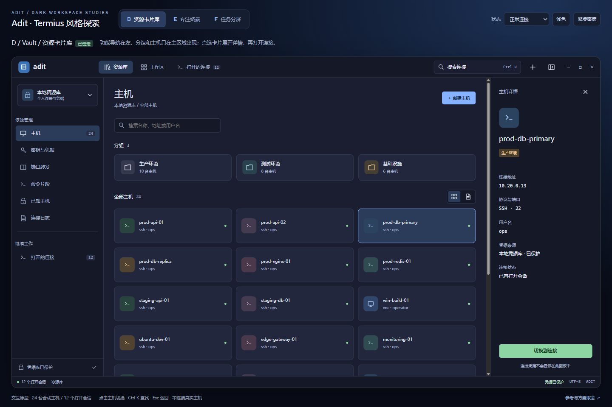
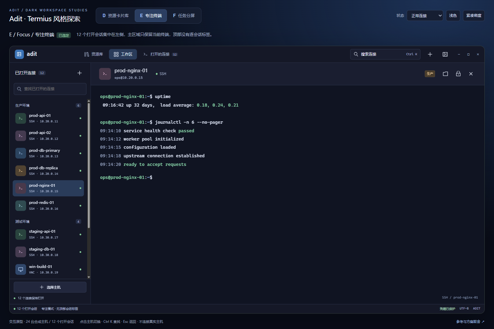
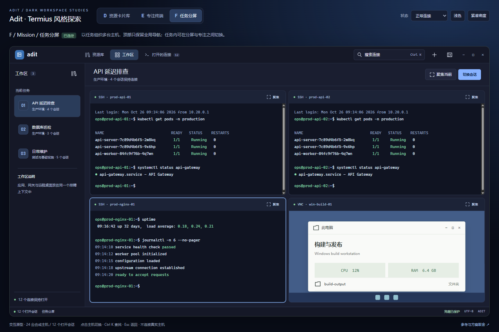

# Adit 已选 UI 方案 D / E / F 与重构交接

日期：2026-10-26。产品基线：`v0.1.76` / `162be845d22409909ea6044d0b46e09386a7e53e`。

用户已于 2026-10-26 明确选定 **D/E/F** 共同组成新 UI。本目录只保留这套交互原型、截图、参考资料和重构交接要求，尚未修改 Rust 产品界面。旧候选原型及其专属截图、生成依赖已从当前版本移除，历史提交仍可追溯。

## 入口

| 文件 | 内容 |
| --- | --- |
| [termius.html](termius.html) | D / E / F：参考 Termius 官网客户端演示的深色视觉方向 |
| [HANDOFF.md](HANDOFF.md) | 给接手 agent 的范围、实现约束、验收要求和可复制提示词 |
| [termius-references.html](termius-references.html) | Termius 风格提取、三版取舍及原型边界 |
| [evidence.json](evidence.json) | 浏览器交互、响应式和内容状态的证据说明 |
| [sha256.json](sha256.json) | 本目录交付文件的 SHA-256；不包含校验清单自身 |

GitHub 文件页面展示的是 HTML 源码，不能直接运行交互。克隆后可直接在浏览器打开唯一入口 `termius.html`；样式和脚本均已内联，不需要 Node、npm、外部字体、旧原型或生成脚本。参考页面需保留在同一目录。

也可从仓库根目录启动只监听本机的预览：

```powershell
python -m http.server 8765 --bind 127.0.0.1 --directory docs/ui-prototypes/2026-10-26
```

然后打开 `http://127.0.0.1:8765/termius.html`。端口冲突时自行换一个空闲端口。

## 已确认的需求与方案

用户已经明确：

- 侧边栏和右侧主区域不应重复展示同一份完整会话/主机清单。
- 打开很多会话时，顶部不应无限增加标签。
- 希望参考主流客户端，并进一步参考 [Termius 官网](https://termius.com/) 的风格。
- 已审阅并选定 D/E/F，由另一个 agent 实施重构。

**D 是资源入口，E 是日常工作区，F 是任务分屏视图；三者均属于本次重构范围。** 不再要求重新选择方案，也不能把 F 降为未批准的后续候选。任务持久化、工作区恢复、团队权限和协作等额外后端能力不因选定界面而自动包含；默认先复用已有会话与分屏能力实现运行期的任务组织。

## 三个已选视图

| 原型 | 侧栏负责什么 | 主区域负责什么 | 会话标签策略 |
| --- | --- | --- | --- |
| D：Vault / 资源卡片库 | 功能导航 | 分组、主机卡片/列表、按需展开的主机详情 | 顶部仅全局导航 |
| E：Focus / 专注终端 | 已打开连接 | 单个活动终端或远程桌面 | 无逐会话顶部标签 |
| F：Mission / 任务分屏 | 任务工作区 | 分屏、当前窗格聚焦 | 顶部仅全局导航 |

### Termius 风格预览

**D：资源卡片库与主机详情**



**E：专注终端**



**F：任务分屏**



## 原型具备的交互

- 24 台合成主机、12 个初始打开会话；分组、搜索与会话切换。
- D 的卡片/列表切换、主机详情和打开/切换连接。
- E 的垂直会话切换和全局切换器，不因隐藏导航项而关闭连接。
- F 的任务切换、窗格聚焦与返回分屏。
- 明暗主题、舒适/紧凑密度、侧栏收起；窄窗口侧栏抽屉。
- 连接中、取消、错误、重试、空、部分失败与只读确认状态。
- 切换器的搜索/方向键/Enter/Esc，弹层焦点保持与返回。
- 合成终端支持 `hostname`、`whoami`、`pwd` 等演示输入。

## 原型不证明什么

所有地址、主机名、终端输出、状态、延迟和远程桌面均为合成数据。原型没有访问个人配置、凭据、真实 SSH/RDP/VNC、操作系统全局快捷键或持久化工作区。

密钥、转发等导航仅有入口预览，未实现完整管理流程。浏览器中的交互通过不能替代原生 iced 界面、远程输入、真实服务器、DPI 或辅助技术验收。刷新页面会恢复初始样本。

## 实现素材与复现

- `termius.html` 是唯一的完整源文件和预览入口，可直接编辑其中的样式、脚本和内容。
- 旧原型入口、覆盖文件和生成脚本已经移除，不存在对旧候选方案的构建依赖。
- 浏览器截图覆盖 `1440×960`、`1024×768` 和 `390×844`；具体归属见 `evidence.json`。
- 仅原型使用这些 HTML/CSS/JS。产品重构应将设计语义转换为原生 iced 组件，不应把原型嵌进 WebView。

产品待办继续在 GitHub Issues 中跟踪，本目录不是新的项目路线图或任务状态来源。
